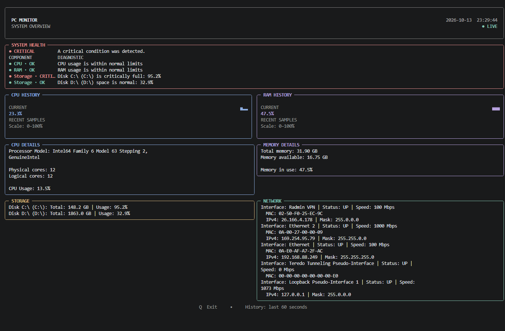

# PC Monitor

A lightweight system resource monitor built with Python and Textual. PC Monitor provides a live terminal dashboard for monitoring CPU, RAM, storage, network interfaces, and GPU telemetry.

## Features

- **CPU monitoring** — processor model, physical and logical core counts, and current usage.
- **Memory monitoring** — total, available, and used RAM.
- **Storage monitoring** — detected volumes, capacity, free space, and usage.
- **Network monitoring** — network interfaces, connection status, IP addresses, and MAC addresses.
- **GPU monitoring** — GPU utilization, VRAM usage, temperature, and clock speeds, when supported by `hw-smi`.
- **Live dashboard** — automatically refreshed terminal interface built with Textual.
- **Usage history** — CPU and RAM history graphs.
- **System health checks** — OK, WARNING, CRITICAL, and UNKNOWN statuses for CPU, RAM, and storage.
- **Keyboard controls** — press `Q` or `Esc` to exit the dashboard.

## Screenshot



## Requirements

- Windows 10 or newer recommended.
- Python 3.10 or newer.
- `pip`.
- A terminal compatible with Textual.
- Administrator privileges for the current hardware-monitoring startup workflow.

GPU telemetry depends on the bundled `hw-smi.exe` utility and compatible hardware and drivers. If GPU data is unavailable, some readings may be displayed as `N/S`.

## Installation

### 1. Clone the repository

```powershell
git clone https://github.com/aleks360944/PC-Monitor-System-Resource-Monitor.git
cd PC-Monitor-System-Resource-Monitor
```

### 2. Create a virtual environment

```powershell
python -m venv .venv
.\.venv\Scripts\Activate.ps1
```

### 3. Install dependencies

```powershell
python -m pip install -r requirements.txt
```

### 4. Run PC Monitor

```powershell
python main.py
```

The application requests administrator privileges on Windows as part of its current startup workflow. Approve the prompt if you want to continue.

Press `Q` or `Esc` to exit the dashboard. You can also use `Ctrl+C` in the terminal.

## GPU Monitoring

PC Monitor uses [hw-smi](https://github.com/ProjectPhysX/hw-smi) by ProjectPhysX to collect GPU telemetry.

The application starts `hw-smi.exe` with logging enabled and reads its generated log files to obtain available GPU readings. The utility is stopped when the dashboard closes.

If GPU readings are unavailable, check that:

- `hw-smi.exe` is present in the expected application directory.
- Your GPU and drivers are supported by `hw-smi`.
- The utility can start and generate a log file.

See [`third_party/hw-smi/LICENSE.md`](third_party/hw-smi/LICENSE.md) for the third-party license. The original utility is not authored by the PC Monitor project.

## Project Structure

```text
PC-Monitor-System-Resource-Monitor/
├── screenshots/
│   └── dashboard.png
├── third_party/
│   └── hw-smi/
│       └── LICENSE.md
├── cpu_monitor.py
├── disk_monitor.py
├── gpu_monitor.py
├── health_checker.py
├── hw-smi.exe
├── main.py
├── network_monitor.py
├── ram_monitor.py
├── ui.py
├── requirements.txt
├── LICENSE
└── README.md
```

## Technologies

- [Python](https://www.python.org/) — application logic.
- [Textual](https://github.com/Textualize/textual) — terminal dashboard framework.
- [Rich](https://github.com/Textualize/rich) — terminal rendering.
- [psutil](https://github.com/giampaolo/psutil) — system resource information.
- [keyboard](https://github.com/boppreh/keyboard) — keyboard input handling.
- [hw-smi](https://github.com/ProjectPhysX/hw-smi) — GPU telemetry.

## License

PC Monitor's own source code is licensed under the MIT License. See [`LICENSE`](LICENSE) for details.

Third-party components retain their respective licenses. In particular, `hw-smi` is distributed under the terms in [`third_party/hw-smi/LICENSE.md`](third_party/hw-smi/LICENSE.md).

## Project Goals

PC Monitor is a practical Python project focused on system monitoring, modular code organization, terminal interfaces, hardware telemetry, and Git-based development.
